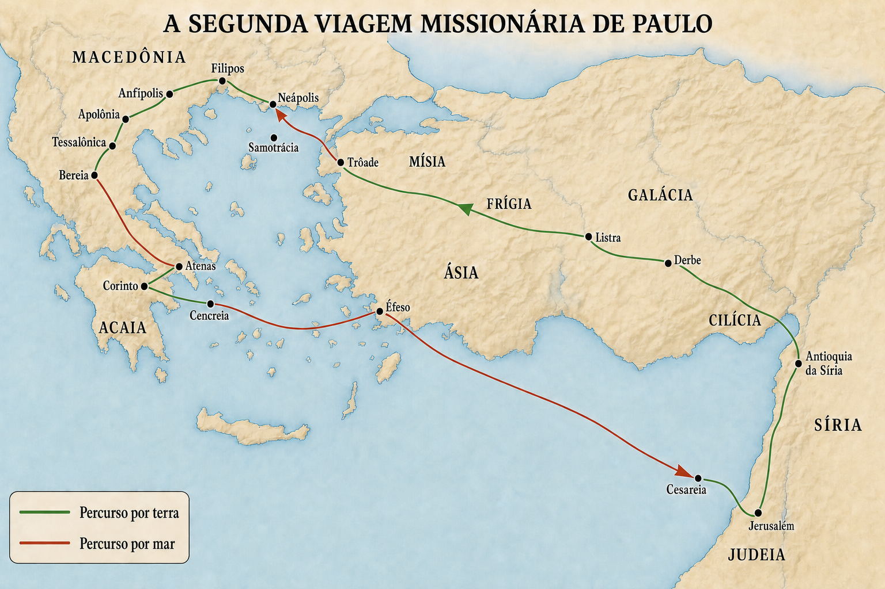

## Filipos: colônia romana e berço da igreja

Filipenses é uma carta pastoral, missionária e profundamente pessoal. Paulo escreve a irmãos que conhecia pelo nome e que participavam de seu ministério desde os primeiros dias do evangelho na Macedônia. Suas exortações nascem de uma amizade amadurecida na cooperação, mas também de pressões concretas: o próprio apóstolo está preso, a comunidade enfrenta oposição externa e há tensões internas que ameaçam a concórdia. Para interpretar Filipenses 4.6–9 sem reduzir o trecho a conselhos isolados de tranquilidade interior, é preciso situar esses versículos na história da cidade, no nascimento daquela igreja e no argumento completo da carta.

O cenário urbano de Filipos ilumina vocábulos que Paulo escolhe ao longo do texto, como cidadania, senhorio, parceria e guarda militar. Originalmente chamada Crênides por causa de suas fontes de água, a cidade foi tomada e rebatizada em 356 a.C. por Filipe II da Macedônia, atraído pela posição estratégica da planície e pelas minas da região. Séculos mais tarde, após as batalhas decisivas de 42 a.C. nas quais Otaviano e Marco Antônio derrotaram os assassinos de Júlio César, Filipos foi refundada como colônia militar romana (*Colonia Iulia Augusta Philippensis*). Veteranos do exército receberam terras ali, o direito itálico (*ius Italicum*) conferiu isenções e garantias jurídicas ao território, e a administração pública, a arquitetura e o latim oficial moldaram a cidade como uma "pequena Roma" no coração da Macedônia.

Essa vocação estratégica era reforçada pela Via Egnácia, a grande estrada pavimentada que atravessava a cidade ligando o mar Adriático ao Oriente. Por esse eixo circulavam tropas, comerciantes, correios imperiais, ideias religiosas e viajantes de diversas províncias. Em um ambiente que valorizava honra pública, títulos imperiais e lealdade a Roma, exortações como "portai-vos como cidadãos dignos do evangelho de Cristo" (1.27) e "a nossa cidade está nos céus, donde também esperamos o Salvador, o Senhor Jesus Cristo" (3.20) adquiriam peso imediato: lembravam aos crentes que sua identidade mais profunda e sua fidelidade última pertenciam ao Senhor exaltado por Deus, e não às garantias de prestígio da colônia.

<figure class="study-figure">
  
  <figcaption><strong>Filipos no itinerário de Paulo:</strong> mapa didático do percurso narrado em Atos 15.40–18.22, reunindo a localização regional da cidade e os trajetos terrestre e marítimo.</figcaption>
</figure>

### Da segunda viagem missionária ao nascimento da igreja em Atos 16

A chegada do evangelho a Filipos ocorreu durante a segunda viagem missionária (At 15.40–18.22). Tendo partido de Antioquia da Síria com Silas, Paulo revisitou comunidades da Síria e da Cilícia, acolheu Timóteo entre Derbe e Listra (At 16.1–3) e atravessou a Frígia e a Galácia até chegar a Trôade, no litoral do mar Egeu. Ali, a visão do homem macedônio que pedia auxílio redirecionou a missão para a Europa (At 16.8–10). A equipe — agora acompanhada pelo narrador de Atos, como indica a passagem do relato para a primeira pessoa do plural — navegou pela ilha da Samotrácia, desembarcou no porto de Neápolis e subiu pela Via Egnácia até Filipos, "primeira cidade desta parte da Macedônia, e colônia" (At 16.11–12). Depois do ministério em Filipos, o roteiro prosseguiria por Anfípolis, Apolônia, Tessalônica e Bereia (At 17.1–15), descendo até Atenas e Corinto — onde Paulo permaneceu por um ano e meio (At 18.1–17) — antes do retorno por Cencreia, Éfeso e Cesareia até Antioquia (At 18.18–22).

<figure class="study-figure">
  
  <figcaption><strong>Trecho da Via Egnácia em Filipos:</strong> a estrada conectava a cidade a uma rede política, militar e comercial muito maior.</figcaption>
</figure>

O relato de Atos 16.13–40 mostra como a igreja filipense nasceu da reunião de pessoas de origens sociais muito distintas. No sábado, fora da porta da cidade, junto ao rio onde havia um lugar de oração, os missionários encontraram mulheres reunidas. Entre elas estava Lídia, comerciante de púrpura natural da cidade de Tiatira e temente a Deus; o Senhor lhe abriu o coração para atender às palavras de Paulo, e ela foi batizada com sua casa, oferecendo em seguida hospedagem insistente à equipe (At 16.14–15).

Pouco depois, a libertação de uma jovem escravizada que possuía espírito de adivinhação e dava grande lucro aos seus senhores desencadeou um conflito público. Vendo perdida sua fonte de ganho, os proprietários arrastaram Paulo e Silas à praça, diante dos magistrados, apelando ao orgulho cívico da colônia: "Estes homens, sendo judeus, perturbam a nossa cidade, e nos expõem costumes que não nos é lícito receber nem praticar, pois que somos romanos" (At 16.20–21). Sem investigação formal, os missionários foram açoitados com varas e lançados no cárcere interior. Naquela noite, após as orações, os cânticos e o terremoto que abriu as portas da prisão, o carcereiro — prestes a tirar a própria vida — ouviu a palavra do Senhor, lavou os vergões dos prisioneiros e creu com toda a sua casa (At 16.25–34). No dia seguinte, Paulo expôs a ilegalidade de terem açoitado publicamente cidadãos romanos sem condenação, obrigando os próprios magistrados a virem conduzi-los com respeito para fora da prisão (At 16.37–39).

Embora Atos não forneça um censo completo da congregação nem restrinja toda a liderança futura a essas três figuras, o episódio inaugural ilumina a memória compartilhada entre o apóstolo e a igreja. A comunidade nasceu em ambiente de oração, hospitalidade doméstica, choque com interesses econômicos e confronto direto com o prestígio romano. Quando Paulo escreve mais tarde sobre sofrer por Cristo e sustentar o mesmo combate que os filipenses já tinham visto nele (1.27–30), seus leitores sabiam por experiência própria o que isso significava.

## Paulo na prisão: ocasião, autoria e envio da carta

A saudação inicial identifica Paulo e Timóteo como "servos de Jesus Cristo" e dirige a carta "a todos os santos em Cristo Jesus que estão em Filipos, com os bispos e diáconos" (1.1). Embora Timóteo apareça associado à abertura e seja elogiado adiante como cooperador sem igual (2.19–22), o texto passa imediatamente à primeira pessoa do singular ("Dou graças ao meu Deus todas as vezes que me lembro de vós", 1.3), mantendo a voz e a experiência pessoal de Paulo do começo ao fim. A autoria paulina é atestada de modo unânime pela tradição cristã antiga e reconhecida amplamente pela crítica histórica.

A condição de prisioneiro não é apenas um detalhe biográfico: ela dá peso concreto ao ensino da epístola. Paulo escreve em cadeias (1.7, 13–14, 17), aguarda um desfecho judicial que pode resultar em libertação ou em execução (1.20–26; 2.17, 23–24) e depende de mensageiros para manter contato com as igrejas. Nessa fragilidade, sua autoridade apostólica se expressa com profundo afeto pastoral, chamando os filipenses de "meus irmãos, muito amados e mui queridos, minha alegria e coroa" (4.1). Ao mesmo tempo, ele se oferece como referencial vivo do evangelho que anuncia: alguém que aprendeu a reputar suas antigas credenciais religiosas como perda diante da excelência do conhecimento de Cristo (3.4–11), que reconhece ainda não ter alcançado a perfeição (3.12–14) e que sabe tanto passar necessidade quanto ter abundância pelo poder daquele que o fortalece (4.11–13). Por isso, quando pede que a igreja o imite (3.17; 4.9), não aponta para uma autossuficiência heroica, mas para uma vida inteiramente moldada pela cruz de Cristo.

### Local da prisão, datação e o papel de Epafrodito

Ao avaliar onde e quando a carta foi redigida, convém distinguir o que o próprio texto declara como certo daquilo que pertence à reconstrução histórica provável ou permanece em debate acadêmico. É **certo**, pela evidência interna, que Paulo está sob custódia militar e que a igreja de Filipos já havia tomado conhecimento dessa prisão, enviando Epafrodito com uma oferta e com a missão de assistir pessoalmente o apóstolo em suas necessidades (2.25; 4.14–18).

Quanto à localização dessa custódia, a leitura tradicional — e historicamente mais **provável** — situa a escrita em Roma, por volta de 60 a 62 d.C., durante a prisão domiciliar sob guarda mencionada em Atos 28.16, 30–31. Sustentam essa identificação a referência às cadeias que se tornaram manifestas "em todo o pretório" (1.13, termo naturalmente associado à guarda pretoriana na capital imperial), a saudação final dos "santos, principalmente os que são da casa de César" (4.22, expressão que designava funcionários, libertos e servos da administração imperial) e a gravidade de um processo cujo veredito final cabia ao tribunal de César.

Permanecem **em debate**, contudo, duas hipóteses alternativas: Éfeso (c. 54–56 d.C.) e Cesareia Marítima (c. 57–59 d.C., cf. At 23.33–26.32). Os defensores de Éfeso argumentam que a menor distância geográfica até Filipos explicaria com mais facilidade as múltiplas viagens e trocas de notícias implícitas na carta — a notícia da prisão de Paulo, a ida de Epafrodito, a notícia de que Epafrodito adoecera, a angústia dele ao saber que a igreja soubera de sua enfermidade e o plano de enviar Timóteo em breve —, lembrando ainda que destacamentos pretorianos e servos imperiais podiam existir em capitais provinciais da Ásia. Cesareia, por sua vez, conta com o registro explícito de uma prisão prolongada em Atos, embora ofereça menos explicação para a expectativa de libertação iminente expressa em 2.24. Qualquer que seja a cidade adotada, a ocasião pastoral não se altera: Paulo escreve sob restrição real de liberdade e risco de morte.

O elo humano imediato entre o apóstolo e a comunidade é Epafrodito. Enviado pelos filipenses para suprir o que faltava ao ministério de Paulo, ele se dedicou ao trabalho de Cristo a ponto de adoecer mortalmente (2.25–30). Restabelecido pela misericórdia divina, Epafrodito ansiava retornar para consolar a igreja que ouvira falar de sua doença, e Paulo o envia de volta com honra — muito provavelmente como portador desta própria carta —, enquanto aguarda o momento de despachar Timóteo e nutre a esperança de visitá-los pessoalmente (2.19–24). Como era costume no mundo antigo, é provável que Paulo tenha ditado o texto a um colaborador, embora a carta não identifique o nome de um secretário.

## O argumento da carta até Filipenses 4.6–9

A unidade de Filipenses nasce da articulação entre notícias pessoais, apelo à firmeza comunitária, cristologia e gratidão missionária. Em toda a epístola, a resposta de Paulo às pressões internas e externas apoia-se em quatro eixos que se entrelaçam continuamente: a **participação no evangelho** (koinōnía), pela qual a igreja ora, sofre, envia cooperadores e reparte bens; a **mente moldada por Cristo** (phronéō), que reorienta ambições, julgamentos e relações; a **alegria no Senhor**, que não depende de circunstâncias favoráveis porque avalia a dor e o perigo a partir da presença de Cristo; e a coerência entre **exemplo e prática**, visível em Cristo, em Paulo, em Timóteo e em Epafrodito.

O movimento da carta desenvolve esses eixos de maneira progressiva. Na abertura (1.1–11), Paulo agradece a Deus pela comunhão constante dos filipenses no evangelho desde o primeiro dia e ora para que o amor deles aumente cada vez mais em conhecimento e em todo o discernimento, a fim de que aprovem as coisas excelentes. Em seguida (1.12–26), informa que suas próprias cadeias serviram para o avanço da mensagem, tornando Cristo conhecido na guarda e encorajando outros irmãos a falarem a palavra com mais ousadia; diante da incerteza do julgamento, declara que viver é Cristo e morrer é ganho. A partir de 1.27–2.18, o apóstolo dirige à comunidade sua exortação central: que se portem de modo digno do evangelho, permanecendo firmes em um só espírito e rejeitando a vanglória e a rivalidade. O fundamento dessa conduta é o próprio movimento de Cristo Jesus, que, subsistindo em forma de Deus, esvaziou-se, humilhou-se até à morte de cruz e foi soberanamente exaltado pelo Pai (2.5–11).

Para mostrar que essa disposição não é um ideal abstrato, Paulo apresenta Timóteo e Epafrodito (2.19–30) como exemplos concretos de cuidado desinteressado e serviço sacrificial. No capítulo 3 (3.1–4.1), adverte a igreja contra aqueles que confiam na carne, expõe sua própria renúncia a todos os privilégios religiosos judaicos para ganhar a Cristo e ser achado nele, e convoca os leitores a prosseguirem para o alvo da soberana vocação de Deus, imitando os que andam segundo o modelo apostólico enquanto aguardam dos céus o Salvador. Esse apelo culmina no limiar do capítulo 4: "Portanto, meus irmãos, muito amados e mui queridos, minha alegria e coroa, estai assim firmes no Senhor, amados" (4.1).

### Delimitação e ideia exegética de Filipenses 4.6–9

Os versículos 6 a 9 pertencem ao bloco de exortações comunitárias iniciado em 4.2 e encerrado antes de 4.10, onde Paulo passa a agradecer formalmente a oferta enviada por meio de Epafrodito (4.10–23). Dentro de 4.2–9, o argumento caminha em três movimentos interligados: primeiro, o cuidado com as **relações** e a postura pública da comunidade (4.2–5), com o rogo direto para que Evódia e Síntique sintam o mesmo no Senhor, o chamado à alegria constante e a ordem para que a moderação dos crentes seja conhecida de todos os homens porque "perto está o Senhor"; depois, o tratamento da **inquietação pela oração** (4.6–7); e, finalmente, a orientação da **mente e da prática** sob a presença do Deus de paz (4.8–9).

> "Não estejais inquietos por coisa alguma" (v. 6) · "a paz de Deus [...] guardará os vossos corações" (v. 7) · "nisso pensai" (v. 8) · "isso fazei" (v. 9).

A **ideia exegética da unidade** pode ser formulada assim: *à comunidade chamada a permanecer firme e reconciliada no Senhor, Paulo ordena que substitua a inquietação dominadora por oração específica e agradecida, promete que a paz de Deus guardará seu interior em Cristo Jesus e orienta-a a ocupar deliberadamente o pensamento com tudo o que corresponde ao bem e a praticar o ensino apostólico recebido e observado, sob a presença do próprio Deus de paz*. Relacionamento com Deus, guarda interior, discernimento moral e obediência comunitária formam, portanto, um único arco contínuo.

## Exegese de Filipenses 4.6–9

Na exposição a seguir, o comentário principal acompanha o fluxo do argumento de Paulo em prosa contínua, integrando os termos gregos transliterados na medida em que iluminam o sentido de cada frase. As gavetas recolhíveis reúnem a análise morfológica e sintática detalhada a partir do texto-base grego (NA28 cotejado com o Textus Receptus, que não apresenta variantes com impacto tradutório nesta perícope) em comparação com a Almeida Corrigida e Fiel (ACF), distinguindo o campo semântico amplo de cada palavra de sua acepção específica no contexto de Filipenses.

4.6

### Da inquietação à oração agradecida

Referência lexical e morfológica · μεριμνάω, προσευχή, δέησις, γνωρίζω

| Expressão e Lema | Morfologia e Sintaxe | Campo Semântico e Sentido na Passagem |
| :--- | :--- | :--- |
| **μηδὲν μεριμνᾶτε** (*mēden merimnate*) Lema: μεριμνάω (*merimnaō*) | Presente ativo imperativo, 2ª pessoa do plural; μηδέν (acusativo neutro singular de οὐδείς/μηδείς) delimita o objeto: "por coisa alguma". | O verbo abrange tanto a preocupação ansiosa que divide e absorve a mente quanto o cuidado responsável por alguém (sentido positivo usado por Paulo para Timóteo em Fp 2.20). Em 4.6, a oposição direta à oração define o valor negativo: não permanecer sob o domínio da inquietação. |
| **ἐν παντί** (*en panti*) Lema: πᾶς (*pas*) | Adjetivo neutro singular no dativo, regido pela preposição ἐν; indica a esfera ou circunstância em que a ação verbal ocorre. | "Em tudo" ou "em toda circunstância". Corresponde simetricamente ao alcance de μηδέν: nenhuma situação deve ficar entregue à ansiedade; todas devem ser levadas a Deus. |
| **τῇ προσευχῇ καὶ τῇ δεήσει** (*tē proseuchē kai tē deēsei*) Lemas: προσευχή; δέησις | Substantivos femininos singulares no dativo instrumental/circunstancial, articulados cada um com seu artigo definido. | Προσευχή designa a oração dirigida a Deus em sentido amplo e reverente; δέησις destaca a súplica ou petição nascida de uma necessidade concreta. Juntos, indicam devoção consciente e pedido urgente. |
| **μετὰ εὐχαριστίας** (*meta eucharistias*) Lema: εὐχαριστία (*eucharistia*) | Substantivo feminino singular no genitivo, regido por μετά (acompanhamento). | Gratidão, reconhecimento por benefícios recebidos. Acompanha a oração e a súplica, recordando a fidelidade passada e presente de Deus enquanto a comunidade ainda aguarda socorro. |
| **τὰ αἰτήματα ὑμῶν γνωριζέσθω** (*ta aitēmata hymōn gnōrizesthō*) Lemas: αἴτημα; γνωρίζω | αἰτήματα: nominativo neutro plural (sujeito); γνωριζέσθω: presente passivo imperativo, 3ª pessoa do singular (concordância grega regular com sujeito neutro plural), com πρὸς τὸν θεόν indicando direção relacional. | Αἴτημα identifica o conteúdo específico pedido; γνωρίζω significa tornar conhecido, declarar ou apresentar. Não implica ignorância divina, mas a apresentação consciente e dependente das necessidades diante de Deus. |

**Fontes consultadas:** BDAG, s.v. μεριμνάω, προσευχή, δέησις, εὐχαριστία, αἴτημα, γνωρίζω; Louw-Nida, domínios 25, 33; [Logeion (LSJ), Universidade de Chicago](https://logeion.uchicago.edu/); NA28 / TR.

Ligando diretamente a ordem à afirmação anterior de que "perto está o Senhor" (4.5), Paulo inicia o versículo 6 com μηδὲν μεριμνᾶτε — *mēdèn merimnâte* ("não estejais inquietos por coisa alguma"). O verbo μεριμνάω — *merimnáō* não é negativo em todas as suas ocorrências: na própria carta, descreve o interesse genuíno e exemplar de Timóteo pelo bem-estar dos filipenses (2.20). Aqui, porém, o contraste imediato com a oração determina seu sentido: Paulo trata da inquietação que absorve a atenção e leva a comunidade a carregar suas ameaças — a prisão do apóstolo, os adversários externos, a escassez e os atritos internos — como se estivesse entregue às próprias forças. O presente imperativo na segunda pessoa do plural dirige-se à igreja inteira e orienta sua postura contínua diante das pressões.

A expressão seguinte estabelece a alternativa em toda a sua extensão: ἐν παντὶ — *en pantí* ("em tudo", isto é, em cada situação enfrentada). Aquilo que em hipótese alguma (mēdén) deve ser governado pela ansiedade deve, em toda circunstância (en pantí), ser apresentado a Deus. Para descrever esse movimento, Paulo reúne três termos do vocabulário de oração que se completam sem redundância vazia: προσευχή — *proseuchḗ* é o termo geral para a oração dirigida a Deus; δέησις — *déēsis* sublinha a súplica motivada por uma carência real; e αἴτημα — *aítēma* nomeia os pedidos concretos apresentados. Orar, portanto, não é um exercício vago de serenidade, mas uma relação com direção, urgência e conteúdo reconhecível.

Esses pedidos devem chegar πρὸς τὸν θεόν ("diante de Deus") acompanhados de μετὰ εὐχαριστίας — *metà eucharistías* ("com ação de graças"). A gratidão não depende de que os problemas já tenham desaparecido; ela recorda o caráter e a fidelidade de Deus já experimentados pela igreja, impedindo que a súplica se feche em murmuração ou desespero. A ordem τὰ αἰτήματα ὑμῶν γνωριζέσθω — *tà aitḗmata hymôn gnōrizésthō* ("sejam conhecidos os vossos pedidos") tampouco sugere que Deus desconheça o que seus filhos enfrentam; ressalta o ato relacional pelo qual a comunidade depõe conscientemente diante do Pai aquilo que a sobrecarrega. Nesse horizonte, convém manter um limite pastoral claro: como a angústia e os transtornos clínicos de ansiedade também podem atingir cristãos fiéis, o mandamento orienta a condução espiritual das preocupações em comunhão com Deus, sem substituir nem hostilizar o cuidado médico e psicológico quando necessário.

4.7

### A paz de Deus como sentinela

Referência lexical e morfológica · εἰρήνη, ὑπερέχω, φρουρέω, καρδία, νόημα

| Expressão e Lema | Morfologia e Sintaxe | Campo Semântico e Sentido na Passagem |
| :--- | :--- | :--- |
| **ἡ εἰρήνη τοῦ θεοῦ** (*hē eirēnē tou theou*) Lema: εἰρήνη (*eirēnē*) | Substantivo feminino singular no nominativo (sujeito de φρουρήσει); τοῦ θεοῦ é genitivo de origem/fonte. | Mais do que ausência de conflito externo, no uso bíblico ecoa o *šālôm* veterotestamentário: integridade, concórdia e segurança que procedem do próprio Deus e de sua presença. |
| **ἡ ὑπερέχουσα πάντα νοῦν** (*hē hyperechousa panta noun*) Lemas: ὑπερέχω; νοῦς | Particípio presente ativo, feminino nominativo singular em posição atributiva; πάντα νοῦν (acusativo masculino singular) indica o objeto excedido. | Ὑπερέχω significa superar, estar acima ou exceder (cf. Fp 2.3; 3.8). Νοῦς designa a faculdade humana de compreender, calcular e julgar. Essa paz ultrapassa a capacidade humana de prever ou resolver plenamente a crise. |
| **φρουρήσει** (*phrourēsei*) Lema: φρουρέω (*phroureō*) | Futuro ativo indicativo, 3ª pessoa do singular. | Guardar com guarnição militar, vigiar, manter sob proteção. Comunica guarda ativa contra invasão hostil, imagem imediatamente compreensível para moradores de uma colônia militar romana. |
| **τὰς καρδίας ὑμῶν καὶ τὰ νοήματα ὑμῶν** (*tas kardias hymōn kai ta noēmata hymōn*) Lemas: καρδία; νόημα | Dois substantivos plurais no acusativo (objetos diretos de φρουρήσει), seguidos de ἐν Χριστῷ Ἰησοῦ (esfera da proteção). | Καρδία abrange o centro interior de afetos, vontade e decisões; νόημα designa os pensamentos, propósitos e percepções que dele procedem. Juntos cobrem a totalidade da vida interior guardada em Cristo. |

**Fontes consultadas:** BDAG, s.v. εἰρήνη, ὑπερέχω, νοῦς, φρουρέω, καρδία, νόημα; Louw-Nida, domínios 22, 26, 30, 37; [Logeion (LSJ), Universidade de Chicago](https://logeion.uchicago.edu/); NA28 / TR.

A conjunção καί ("e") no início do versículo 7 tem valor consecutivo: apresenta o resultado prometido por Deus quando a comunidade lhe entrega suas inquietações em oração agradecida. No lugar do tumulto interior, ἡ εἰρήνη τοῦ θεοῦ — *hē eirḗnē tou theoû* ("a paz de Deus") assume a ação principal da frase. O genitivo indica sua origem e sua natureza: não se trata de um equilíbrio produzido por técnicas de controle emocional nem da simples cessação das hostilidades ao redor, mas da paz que pertence a Deus e que ele concede ao seu povo.

Paulo qualifica essa paz como ὑπερέχουσα πάντα νοῦν — *hyperéchousa pánta noûn* ("que excede todo o entendimento"). O substantivo νοῦς — *noûs* refere-se à mente em sua capacidade de avaliar cenários, projetar soluções e buscar garantias. Diante de uma prisão cujo desfecho ainda era incerto e de adversidades que a igreja não podia controlar, o cálculo humano rapidamente se esgota. Dizer que a paz de Deus supera todo entendimento significa que ela opera onde os recursos de previsão e controle falham; ela não anula o exercício da razão — que será ordenado logo no versículo 8 —, mas sustenta a comunidade mesmo quando o cenário permanece inexplicado.

O verbo central da promessa é φρουρήσει — *phrourḗsei* ("guardará"), de φρουρέω — *phrouréō*, termo empregado para a vigilância exercida por uma guarnição militar que protege uma cidade contra ataques. Para leitores acostumados à presença de veteranos e sentinelas romanas em Filipos, a metáfora era viva: a paz de Deus monta guarda sobre o território interior da igreja. Esse território é descrito pela dupla καρδία — *kardía* ("corações", a sede das afeições, da vontade e das disposições fundamentais) e νόημα — *nóēma* ("pensamentos", os raciocínios, desígnios e avaliações que nascem do coração). Longe de traçar uma dicotomia moderna entre emoção e intelecto, Paulo afirma que a pessoa interior inteira é protegida ἐν Χριστῷ Ἰησοῦ ("em Cristo Jesus"), a esfera salvadora fora da qual essa segurança não existe. Note-se a precisão da relação com o versículo 6: a promessa garante que a paz de Deus guardará os crentes em Cristo, enquanto o modo e o tempo de resposta a cada pedido específico permanecem sob a soberana sabedoria divina.

4.8

### Uma mente treinada para reconhecer o bem

Referência lexical e morfológica · ἀληθής, σεμνός, δίκαιος, ἁγνός, λογίζομαι

| Expressão e Lema | Morfologia e Sintaxe | Campo Semântico e Sentido na Passagem |
| :--- | :--- | :--- |
| **ὅσα ἐστὶν ἀληθῆ, ὅσα σεμνά** (*hosa estin alēthē, hosa semna*) Lemas: ἀληθής; σεμνός | Pronome correlativo neutro plural ὅσα ("tudo o que", repetido seis vezes) com adjetivos predicativos no nominativo neutro plural. | Ἀληθής: verdadeiro, real, infenso à falsidade e ao boato. Σεμνός: digno de respeito, honrado, dotado de gravidade moral. Abrem a série ancorando a mente na realidade e na dignidade ética. |
| **ὅσα δίκαια, ὅσα ἁγνά** (*hosa dikaia, hosa hagna*) Lemas: δίκαιος; ἁγνός | Adjetivos neutros plurais no nominativo, coordenados pela anáfora de ὅσα. | Δίκαιος: justo, reto, conforme ao caráter de Deus e aos deveres para com o próximo. Ἁγνός: moralmente puro, íntegro, sem mistura de malícia ou corrupção. |
| **ὅσα προσφιλῆ, ὅσα εὔφημα** (*hosa prosphilē, hosa euphēma*) Lemas: προσφιλής; εὔφημος | Adjetivos neutros plurais no nominativo; ambos ocorrem apenas aqui em todo o Novo Testamento (*hapax legomena*). | Προσφιλής: amável, que promove concórdia e afeição legítima. Εὔφημος: de boa fama, digno de menção aprovadora. Subordinados à verdade e à justiça iniciais, excluem mera busca de aplauso. |
| **εἴ τις ἀρετὴ καὶ εἴ τις ἔπαινος** (*ei tis aretē kai ei tis epainos*) Lemas: ἀρετή; ἔπαινος | Orações condicionais de realidade com substantivos femininos/masculinos singulares no nominativo, recapitulando os seis adjetivos anteriores. | Ἀρετή designa excelência moral ou virtude; ἔπαινος, aquilo que merece aprovação e louvor legítimo. Ampliam e sintetizam a lista: onde quer que haja verdadeira excelência digna de louvor. |
| **ταῦτα λογίζεσθε** (*tauta logizesthe*) Lema: λογίζομαι (*logizomai*) | Presente médio (depoente) imperativo, 2ª pessoa do plural; ταῦτα (acusativo neutro plural) retoma toda a série como objeto direto. | Calcular, ponderar, avaliar cuidadosamente, levar em conta de modo deliberado. Exige reflexão contínua e discernimento ativo, não devaneio ou esvaziamento mental. |

**Fontes consultadas:** BDAG, s.v. ἀληθής, σεμνός, δίκαιος, ἁγνός, προσφιλής, εὔφημος, ἀρετή, ἔπαινος, λογίζομαι; Louw-Nida, domínios 30, 65, 72, 88; [Logeion (LSJ), Universidade de Chicago](https://logeion.uchicago.edu/); NA28 / TR.

A guarda divina prometida no versículo 7 não reduz a igreja à passividade mental; pelo contrário, habilita-a para a ordem que abre o versículo 8 com τὸ λοιπόν, ἀδελφοί ("quanto ao mais, irmãos"). Por meio da repetição enfática do pronome ὅσα — *hósa* ("tudo o que") seis vezes seguidas, seguida de duas cláusulas recapitulativas ("se há alguma virtude e se há algum louvor"), Paulo estabelece os critérios pelos quais a comunidade deve filtrar e alimentar seus pensamentos habituais.

A ordem dos seis adjetivos neutros plurais é reveladora. A série começa com ἀληθῆ — *alēthê* ("tudo o que é verdadeiro"), exigindo que o pensamento cristão se apoie na verdade do evangelho e na realidade dos fatos, recusando suspeitas infundadas, murmurações e aparências enganosas. Segue-se σεμνά — *semná* ("tudo o que é honesto" / digno de respeito), termo que descreve o que possui seriedade e nobreza moral em contraste com a leviandade. O terceiro e o quarto termos, δίκαια — *díkaia* ("justo") e ἁγνά — *hagná* ("puro"), voltam a atenção para aquilo que cumpre retamente as obrigações diante de Deus e dos homens e permanece incontaminado em suas motivações. Os dois últimos adjetivos — προσφιλῆ — *prosphilê* ("amável") e εὔφημα — *eúphēma* ("de boa fama") — contemplam a dimensão relacional e pública do bem: o que desperta afeição fraterna e merece ser reconhecido com honra. Como a lista é encabeçada pela verdade e pela justiça, essa amabilidade e boa reputação nada têm a ver com conveniência social ou busca de popularidade.

As expressões condicionais "se há alguma virtude (aretḗ) e se há algum louvor (épainos)" resumem os seis qualificadores anteriores. Embora termos como aretḗ fossem correntes na filosofia moral greco-romana, Paulo não adota uma ética autônoma: ele convoca a igreja a reconhecer e ponderar toda excelência moral genuína sob a medida de Cristo e do ensino apostólico explicitado logo no versículo 9. O imperativo ταῦτα λογίζεσθε — *taûta logízesthe* ("nisso pensai"), do verbo λογίζομαι — *logízomai*, significa avaliar com cuidado, levar em conta e manter a mente ocupada de forma deliberada. Em uma comunidade onde duas cooperadoras como Evódia e Síntique estavam em desacordo (4.2–3), esse treino do pensamento tinha efeito imediato: obrigava os irmãos a substituírem a ruminação de queixas, rivalidades e maus juízos pelo reconhecimento lúcido do que era verdadeiro, justo e digno de apreço na caminhada comum.

4.9

### Do ensino observado à prática perseverante

Referência lexical e morfológica · μανθάνω, παραλαμβάνω, πράσσω, ὁ θεὸς τῆς εἰρήνης

| Expressão e Lema | Morfologia e Sintaxe | Campo Semântico e Sentido na Passagem |
| :--- | :--- | :--- |
| **ἃ καὶ ἐμάθετε καὶ παρελάβετε** (*ha kai emathete kai parelabete*) Lemas: μανθάνω; παραλαμβάνω | Pronome relativo neutro plural ἅ ("o que") com dois aoristos ativos indicativos, 2ª pessoa do plural, coordenados por καί... καί. | Μανθάνω contempla o processo de instrução e aprendizado; παραλαμβάνω é o termo técnico para acolher uma tradição ensinada com autoridade (cf. 1Co 11.23; 15.1, 3). Recordam a formação doutrinária histórica da igreja. |
| **καὶ ἠκούσατε καὶ εἴδετε ἐν ἐμοί** (*kai ēkousate kai eidete en emoi*) Lemas: ἀκούω; ὁράω | Aoristo ativo indicativo (ἠκούσατε) e segundo aoristo ativo indicativo (εἴδετε), 2ª pessoa do plural; ἐν ἐμοί localiza o ensino na pessoa e conduta do apóstolo. | Ἀκούω refere-se ao ensino ouvido na pregação e no trato pastoral (e às notícias sobre a firmeza de Paulo); ὁράω aponta para o testemunho ocular da conduta do apóstolo em Filipos. |
| **ταῦτα πράσσετε** (*tauta prassete*) Lema: πράσσω (*prassō*) | Presente ativo imperativo, 2ª pessoa do plural; ταῦτα retoma os quatro verbos anteriores como objeto direto. | Praticar continuamente, executar como conduta habitual. Converte a ponderação mental de λογίζεσθε (v. 8) em ação concreta e perseverante. |
| **καὶ ὁ θεὸς τῆς εἰρήνης ἔσται μεθ’ ὑμῶν** (*kai ho theos tēs eirēnēs estai meth’ hymōn*) Lemas: θεός; εἰρήνη; εἰμί | Nominativo masculino singular com genitivo caracterizador (τῆς εἰρήνης); ἔσται é futuro indicativo de εἰμί, 3ª pessoa do singular, com μεθ’ ὑμῶν (companhia/presença). | "O Deus de paz estará convosco". Retoma e aprofunda a promessa do v. 7: da "paz de Deus" que guarda o coração passa-se à presença pessoal do próprio Deus que é a fonte da paz. |

**Fontes consultadas:** BDAG, s.v. μανθάνω, παραλαμβάνω, ἀκούω, ὁράω, πράσσω, εἰρήνη; Louw-Nida, domínios 27, 33, 41; [Logeion (LSJ), Universidade de Chicago](https://logeion.uchicago.edu/); NA28 / TR.

O versículo 9 impede que a reflexão ordenada no versículo 8 permaneça no plano da contemplação teórica ou seja preenchida por padrões morais vagos. Paulo amarra o discernimento da igreja à formação concreta que ela já havia recebido por meio de quatro verbos no aoristo indicativo, dispostos em dois pares coordenados (καὶ... καὶ... καὶ... καὶ): ἃ καὶ ἐμάθετε — *hà kaì emáthete* ("o que também aprendestes"), καὶ παρελάβετε — *kaì parelábete* ("e recebestes"), καὶ ἠκούσατε — *kaì ēkoúsate* ("e ouvistes"), καὶ εἴδετε ἐν ἐμοί — *kaì eídete en emoí* ("e vistes em mim"). O primeiro par destaca a instrução catequética e a recepção fiel do depósito apostólico; o segundo une a palavra proclamada por Paulo à sua conduta visível entre os filipenses desde os dias de Atos 16. O evangelho não chegou a Filipos apenas como discurso, mas encarnado em uma vida que podia ser observada sob açoites, na prisão, na hospitalidade e nas cadeias presentes.

Tendo recordado essa quádrupla ancoragem, o apóstolo emite o imperativo conclusivo da perícope: ταῦτα πράσσετε — *taûta prássete* ("isso fazei" / "continuai praticando essas coisas"). Enquanto no versículo 8 o pronome taûta era objeto de logízesthe ("ponderai essas coisas"), aqui o mesmo taûta torna-se objeto de prássete ("praticai essas coisas"). O presente imperativo exige prática reiterada e habitual. Ao apontar para o que os filipenses viram nele, Paulo não reivindica impecabilidade pessoal — no capítulo anterior ele mesmo declarou que ainda prossegue para alcançar aquilo para o que também foi alcançado por Cristo Jesus (3.12) —, mas confirma que doutrina, caráter do mestre e prática da comunidade devem atestar-se mutuamente.

A promessa que encerra a unidade retoma e aprofunda aquela do versículo 7 em uma progressão deliberada: se no versículo 7 "a paz de Deus" (hē eirḗnē tou theoû) guardará os corações e os pensamentos da igreja, no versículo 9 "o Deus de paz" (ho theòs tês eirḗnēs) estará com ela (éstai meth’ hymôn). A atenção se desloca do dom protetor para a companhia pessoal do próprio Doador. A presença do Deus de paz acompanha a comunidade enquanto ela ora em meio às aflições, submete seus pensamentos à verdade e pratica perseverantemente o evangelho aprendido.

## Síntese teológica e horizonte pastoral

Para atravessar com fidelidade a distância entre a Filipos do primeiro século e a igreja contemporânea, a aplicação precisa respeitar o caminho desenhado pela própria gramática e pelo contexto histórico da carta. Paulo não escreveu essas palavras a indivíduos isolados em busca de serenidade privada, mas a uma congregação inteira que enfrentava hostilidade externa, preocupação com seu apóstolo encarcerado, desafios materiais e atritos internos entre cooperadores. Ao longo dos quatro versículos, os imperativos conduzem da renúncia à inquietação dominadora para a oração agradecida (v. 6), desta para a avaliação disciplinada do que ocupa a mente (v. 8) e, por fim, para a prática contínua do ensino apostólico (v. 9), sempre sustentados pelas promessas da guarda da paz de Deus (v. 7) e da presença do Deus de paz (v. 9) "no Senhor" e "em Cristo Jesus".

O **princípio teológico central** da perícope decorre diretamente dessa articulação: *unida a Cristo, a igreja responde às pressões reais da vida levando suas necessidades a Deus com gratidão, submetendo sua atenção ao que é verdadeiro e justo segundo o evangelho e praticando de modo perseverante a sã doutrina aprendida e observada, confiante de que a guarda e a presença do Deus de paz a sustentam mesmo quando as circunstâncias adversas permanecem*. A fé bíblica envolve a pessoa e a comunidade por inteiro — afetos, oração, raciocínio, relacionamentos e auxílio concreto.

Na vida da igreja hoje, esse ensino confronta diretamente ambientes marcados por ruminação ansiosa, consumo passivo de boatos e desinformação, polarização entre irmãos e dissociação entre ortodoxia professada e conduta diária. Filipenses 4.6–9 chama os crentes a darem nome às suas necessidades diante de Deus sem esquecer as razões de gratidão, a examinarem com rigor o que alimenta sua mente cotidianamente, a valorizarem referenciais maduros de discipulado nos quais palavra e vida caminham juntas e a converterem a preocupação em serviço fraterno e parceria missionária — como os próprios filipenses fizeram ao socorrer Paulo por meio de Epafrodito.

Por fim, a integridade exegética exige preservar os limites pastorais do próprio texto. Em primeiro lugar, sentir o peso da ansiedade ou atravessar um quadro clínico de sofrimento psíquico não constitui, por si só, prova de incredulidade ou de pecado específico; no cuidado de pessoas aflitas, a igreja honra a Deus quando une oração perseverante, escuta acolhedora, comunhão prática e encaminhamento médico e psicológico responsável, reconhecendo esses recursos como parte da boa providência divina. Em segundo lugar, a ordem de apresentar os pedidos a Deus submete cada súplica à sabedoria do Pai: o texto garante a guarda interior da paz de Deus em Cristo, não a remoção imediata das cadeias ou das provações. Em terceiro lugar, "nisso pensai" (v. 8) não ensina técnicas de pensamento positivo ou negação da dor, mas o discernimento moral ancorado na verdade (v. 8) e na prática apostólica (v. 9), onde a paz de Deus floresce junto da reconciliação, da justiça e da obediência perseverante.
