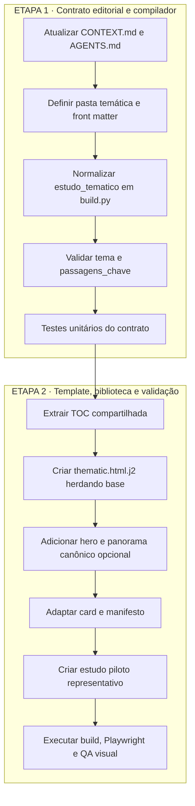

# Especificação Técnica e Plano de Implementação: Suporte a Estudos Temáticos Bíblicos

> **Status:** Proposta revisada; ainda não implementada
> **Destinatário:** Auditoria Sênior / Engenharia de Produto
> **Data:** 2026-09-10
> **Branch Alvo:** `Refinos`

---

## 1. Diagnóstico do Domínio e Motivação

O repositório opera atualmente com dois perfis editoriais:
1. **Devocional / Estudo Rápido** (`devocional.html.j2`): leitura pastoral, reflexiva, foco na aplicação e autoexame.
2. **Estudo Exegético** (`exegetical.html.j2`): investigação histórico-gramatical centrada em uma passagem, organizada por unidades ou versículos conforme o conteúdo.

### Limitação Estrutural para Estudos Doutrinários e Temáticos
Quando o objetivo pedagógico e teológico é investigar uma doutrina ou tema bíblico (ex.: *A Imutabilidade de Deus*, *A Justificação pela Fé* ou *A Justiça no Livro de Amós*):
- **O estudo não pertence a um único livro ou versículo:** reúne um corpo canônico de passagens do Antigo e do Novo Testamento.
- **A progressão não é necessariamente linear:** pode seguir perguntas, eixos bíblico-teológicos, relações canônicas, objeções e implicações pastorais, desde que cada conclusão permaneça ligada ao contexto das passagens examinadas.
- **O template exegético atual comunica um recorte diferente:** seu rótulo, o bloco “Tese da passagem” e a apresentação da biblioteca pressupõem uma passagem focal. A TOC e a gaveta lexical já são reutilizáveis e não precisam de uma segunda implementação; o que falta é uma composição editorial e um contrato de metadados próprios para o estudo temático.

### Decisão Arquitetural: Extensão Especializada via `thematic.html.j2`
Em vez de sobrecarregar o template exegético com condicionais de composição, a implementação deverá criar o **Perfil 3: Estudo Temático** (`estudo_tematico`). Ele reutilizará os fundamentos estáveis do ecossistema:
- Template base (`base.html.j2`) com topbar unificada e ação Imprimir/PDF.
- Design System *Paper & Forest* (`assets/study.css`).
- Script de navegação, rolagem sincronizada de tópicos e isolamento de scroll (`assets/study.js`).
- Compilador estático idempotente com sanitização de PDF sem timestamps voláteis (`build.py`).

---

## 2. Visão Geral das Duas Etapas

A execução é dividida em duas etapas lógicas para viabilizar auditoria antes da geração de artefatos finais:



---

## 3. Detalhamento da ETAPA 1: Contrato Editorial e Compilador

### 3.1. Contrato do Front Matter YAML (`estudo_tematico`)
O front matter para estudos temáticos expande o contrato de forma retrocompatível:

```yaml
---
id: a-imutabilidade-de-deus
tipo: estudo_tematico
titulo: "A Imutabilidade de Deus: A Rocha Inabalável em um Mundo Instável"
tema: "Teologia Própria · Atributos Divinos"
resumo: "Uma investigação bíblica e sistemática sobre a constância eterna do ser, conselho e promessas de Deus à luz do Antigo e Novo Testamento."
traducao: ACF
data: "2026-09-10"
autor: "Alex Coelho"
status: rascunho
homiletica: false
# Campo 'passagem' tradicional resume as âncoras principais para listas e cards
passagem: "Ml 3.6; Tg 1.17; Sl 102.25-27; Hb 6.17-18"
# Panorama opcional. Cada item exige ref; texto contém apenas um excerto conferido.
passagens_chave:
  antigo_testamento:
    - ref: "Malaquias 3.6"
    - ref: "Salmo 102.25-27"
    - ref: "Números 23.19"
  novo_testamento:
    - ref: "Tiago 1.17"
    - ref: "Hebreus 13.8"
    - ref: "Hebreus 6.17-18"
tags:
  - atributos-de-deus
  - teologia-propria
  - teologia-biblica
---
```

Regras do contrato:

- `tema` é obrigatório quando `tipo` for `estudo_tematico`; os demais tipos preservam o contrato atual.
- `passagem` continua obrigatório como resumo curto das âncoras, garantindo compatibilidade com a topbar, o catálogo e o manifesto.
- `passagens_chave` é opcional. Quando presente, aceita somente o objeto acima, com as chaves `antigo_testamento` e `novo_testamento`; cada chave contém uma lista de objetos com `ref` obrigatória e `texto` opcional.
- A ausência de uma das listas é válida. Uma lista vazia não renderiza coluna, título ou espaço residual no template.
- O compilador valida tipos e campos com erro acionável. Não tenta inferir o testamento pela grafia da referência nem completar excertos bíblicos automaticamente.
- Um `texto` informado deve ser tratado como citação editorial: a conferência da tradução e da referência pertence à criação/revisão do estudo, não ao compilador.

### 3.2. Alterações no `build.py`
1. **Normalização de Tipo (`normalize_type`):**
   - Aceitar `"estudo_tematico"`, `"tematico"`, `"estudo_doutrinario"`, convertendo canonicamente para `"estudo_tematico"`.
   - `DEFAULT_TRANSLATIONS["estudo_tematico"] = "ACF"` (preservando o rigor histórico-gramatical como padrão).
2. **Normalização de `passagens_chave` (`normalize_metadata`):**
   - Aplicar o contrato único descrito acima e devolver uma estrutura normalizada previsível para o template.
   - Exigir `tema` apenas no perfil temático e preservar os dois perfis existentes.
3. **Mapeamento de Template (`render_study`):**
   ```python
   TEMPLATE_BY_TYPE = {
       "devocional": "devotional.html.j2",
       "estudo_exegetico": "exegetical.html.j2",
       "estudo_tematico": "thematic.html.j2",
   }
   template_name = TEMPLATE_BY_TYPE[study.metadata["tipo"]]
   ```
   - O acesso direto é intencional: um tipo normalizado sem template deve interromper o build, em vez de ser silenciosamente renderizado como estudo exegético.
4. **Sumário (`enrich_toc` e componente compartilhado):**
   - Preservar a regra atual: `h2` numerados e níveis inferiores com o título completo. Um subtítulo como `### Tiago 1.17 — O Pai das Luzes sem variação` já apresenta a coordenada bíblica sem exigir um parser novo para os 66 livros.
   - Extrair o markup repetido da TOC de `devotional.html.j2` e `exegetical.html.j2` para `templates/components/toc.html.j2`, reutilizado também por `thematic.html.j2`.
5. **Atualização do Catálogo (`card_for` e `index.html.j2`):**
   - Incluir `tema` no card/manifesto e mapear os três rótulos explicitamente; nenhum `else` deve rotular um tipo desconhecido como exegético.
    - O card renderiza `"Estudo temático"`, a passagem resumida e o tema sem repetir a mesma informação em duas linhas.
6. **Abertura de Links Externos em Nova Aba (`target="_blank"`):**
    - No pós-processamento de Markdown (`render_markdown`), injetar automaticamente `target="_blank"` e `rel="noopener noreferrer"` em todas as tags `<a>` que apontam para URLs absolutas externas (`http://` ou `https://`), preservando âncoras locais (`#id`) e links relativos na mesma aba.

### 3.3. Convenção de Pasta e Documentação Canônica

- Acrescentar ao `AGENTS.md` a convenção `Pregações/AAAA-MM-DD - [Tema] - Estudo temático/`, pois o padrão atual exige livro, passagem e igreja e não representa esse perfil.
- Atualizar o `CONTEXT.md` para registrar o terceiro perfil, sua tradução padrão ACF, a submissão da síntese temática à exegese contextual de cada passagem e o caráter opcional da homilética.
- Formalizar no `CONTEXT.md` e no `AGENTS.md` os léxicos de referência prioritários:
  - **Grego (NT):** BDAG (padrão principal), Louw-Nida (domínios semânticos), ou os melhores disponíveis (Liddell-Scott-Jones via Logeion, Thayer, Abbott-Smith).
  - **Hebraico/Aramaico (AT):** HALOT (padrão principal), DCH (hebraico clássico), ou os melhores disponíveis (BDB, Gesenius).
- Criar o piloto em `Pregações/2026-09-10 - A Imutabilidade de Deus - Estudo temático/estudo.md`.
- Não transformar a lista de seções sugeridas em schema obrigatório: o corpo do Markdown continua determinando a composição real.

### 3.4. Testes Unitários de Regressão (`tests/test_build.py`)

- Aceitação dos aliases documentados e rejeição de tipo desconhecido.
- Tradução padrão ACF e sobrescrita explícita por outra tradução.
- Obrigatoriedade de `tema` somente para o perfil temático.
- Normalização de `passagens_chave`, incluindo uma lista ausente, `texto` opcional e erros de tipo ou `ref` ausente.
- Seleção de `thematic.html.j2`, conteúdo do card/manifesto e preservação dos dois perfis existentes.
- Renderização HTML com `skip_pdf=True`; a geração e a inspeção do PDF permanecem testes de integração do build completo.

---

## 4. Detalhamento da ETAPA 2: Frontend, Template Editorial e UI/UX

A experiência visual e pedagógica seguirá a rota já definida no repositório: `learning-experience-ux` lidera a experiência de estudo; `imagens-estudos` orienta a apresentação bíblica; `product-experience-quality` revisa clareza, estados e acessibilidade; `estudos-teologicos` governa método e evidência; `revisao-textual` governa a redação. A identidade *Paper & Forest* será expandida, não redesenhada.

### 4.1. Seções Estruturais de um Estudo Temático no Markdown

O leitor de um estudo temático precisa de uma trajetória cognitiva clara. As seções abaixo são uma composição recomendada para o piloto, não um formulário obrigatório para todos os temas:

1. **Definição Doutrinária e Tese Central:**
   - O que a Escritura afirma e o que ela *não* afirma sobre o tema.
   - Quadro conceitual claro: definição clássica (ex.: imutabilidade não é estática inerte, mas fidelidade perfeita e viva).
2. **Fundamento Canônico no Antigo Testamento:**
   - Exegese histórica dos textos fundamentais da Antiga Aliança (a fidelidade da aliança, a transcendência de Deus frente à criação temporal).
3. **Plenitude e Cumprimento no Novo Testamento:**
   - Como o Novo Testamento desenvolve o tema e suas relações cristológicas quando as passagens examinadas sustentarem essa conexão.
4. **Objeções Bíblicas e Tensões Hermenêuticas:**
   - Tratamento honesto e profundo de passagens de aparente tensão (ex.: antropopatias/antropomorfismos em *“Deus se arrependeu”* em Gn 6.6 e Jn 3.10 vs. Nm 23.19 e 1Sm 15.29).
   - Uso de gavetas retráteis (`<details class="lex-drawer">`) somente para dados lexicais e gramaticais verificados que esclareçam cada passagem em seu próprio contexto. Sem criar equivalências automáticas entre termos hebraicos e gregos.
5. **Cristocentrismo e Aplicação Pastoral:**
   - Relação com Jesus Cristo quando demonstrada pelo desenvolvimento canônico, como em *Hb 13.8* no estudo piloto.
   - Confiança nas promessas e cuidado pastoral diante da instabilidade, sem tratar ansiedade clínica como simples falha espiritual nem substituir acompanhamento profissional quando necessário.

### 4.2. Estrutura do Novo Template (`templates/thematic.html.j2`)

O template mantém a casca e os estilos comprovados do `study-shell`, introduzindo módulos específicos:

1. **Hero Temático (`.hero--thematic`):**
   - *Eyebrow:* `Estudo temático · Doutrina bíblica`
   - Título principal e subtítulo temático (`.theme-badge`).
   - Resumo e metadados (Data, Autor, Tradução-base, Tema).
2. **Painel Canônico de Passagens (`.canonical-matrix`):**
   - Um panorama opcional em duas regiões semânticas: **Antigo Testamento** e **Novo Testamento**, cada uma com referências e excertos breves somente quando fornecidos.
   - Se houver apenas uma região, ela ocupa a largura disponível; se não houver `passagens_chave`, o módulo inteiro desaparece sem deixar espaço vazio.
   - O módulo orienta a leitura, mas não duplica longas transcrições que pertencem ao corpo do estudo.
3. **Barra Lateral Inteligente (`.toc`):**
   - Preserva exatamente a rolagem sincronizada, scrollbar estreita de 4px e isolamento de boundary (`wheel`).
   - Apresenta as seções numeradas (`01`, `02`, `03`...) e mantém referências bíblicas no próprio título dos subtópicos, sem inferência automática.
4. **Gavetas Lexicais Doutrinárias (`.lex-drawer`):**
   - Utiliza a mesma UI refinada com botão único superior (`[ Consultar léxico ▾ ]` / `[ Recolher ▴ ]`) e scroll interno contido (`.lex-drawer-body`), sem vazamento superior.

### 4.3. Refinamentos CSS (`assets/study.css`)
Adição de regras pontuais, limpas e não intrusivas:
- `.study-card--estudo_tematico`: variação de borda e kicker que não dependa apenas de cor para comunicar o tipo.
- `.canonical-matrix`: grid responsivo (2 colunas em desktop, 1 coluna em mobile <860px) com fundo `--paper-2` e tipografia de citação em `--font-serif`.
- Impressão / PDF (`@media print`): matriz canônica preservada sem quebras desnecessárias de página.
- Estados de foco, ordem semântica e contraste medido devem preservar as regras de acessibilidade do `CONTEXT.md`, inclusive WCAG AAA no texto principal.

---

## 5. Plano de Verificação e Controle de Qualidade

Ao executar a implementação, os seguintes testes objetivos deverão ser cumpridos e registrados:

1. **Testes Unitários:**
   - Execução de `py -X utf8 -m unittest discover tests` cobrindo o novo contrato e as regressões dos perfis existentes.
2. **Compilação Estática Completa:**
   - `py -X utf8 build.py` gerando HTML, PDF, manifesto e índice sem erros.
   - Executar dois builds consecutivos e comparar `dist/` para preservar a idempotência já exigida pelo projeto.
3. **Auditoria Visual Automatizada (Playwright / Chromium):**
   - Ampliar `tests/frontend_qa.py` em vez de criar uma segunda suíte.
   - Verificação em viewports Mobile (390x844), Tablet (768x900) e Desktop (1440x900).
   - Verificação de ausência de erros JavaScript, destinos quebrados na TOC e overflow horizontal (`scrollWidth === clientWidth`).
   - Teste de rolagem sincronizada: rolagem da página principal deve deslizar o menu de tópicos temáticos.
   - Teste de isolamento da roda do mouse: rolar o menu lateral não deve alterar `window.scrollY`.
   - Verificação do panorama com duas regiões, uma região, sem panorama, título longo, excerto longo e navegação por teclado.
   - Reexecutar os cenários existentes de devocional, exegético, biblioteca, favicon e cards para detectar regressões.
4. **Verificação de PDF:**
   - Confirmar arquivo PDF válido, A4, gavetas lexicais abertas, links legíveis, ausência de cortes e metadados temporais normalizados.
   - Inspecionar visualmente páginas representativas; a existência do arquivo, sozinha, não comprova a composição.
5. **Verificações finais:**
   - `py -X utf8 -m py_compile build.py server.py tests/test_build.py tests/frontend_qa.py` e `git diff --check`.
   - Registrar separadamente o que foi comprovado localmente e no CI. Não publicar, fazer merge ou alterar permissões sem pedido explícito.

---

## 6. Critério de Aprovação para o Auditor Sênior

A implementação somente poderá ser aprovada quando houver evidência de que:

- o terceiro perfil é reconhecido, validado e renderizado sem fallback silencioso;
- devocionais e estudos exegéticos continuam passando nos testes funcionais e visuais existentes;
- `thematic.html.j2` herda `base.html.j2`, reutiliza a TOC compartilhada e consome os assets consolidados;
- o piloto demonstra síntese temática sem apagar o contexto histórico-gramatical das passagens nem impor uma escola teológica como ponto de partida;
- biblioteca, manifesto, HTML e PDF representam corretamente o novo tipo;
- `AGENTS.md`, `CONTEXT.md` e a convenção de pastas correspondem ao comportamento implementado;
- o build completo permanece reproduzível e a interface foi validada no navegador e no PDF.
